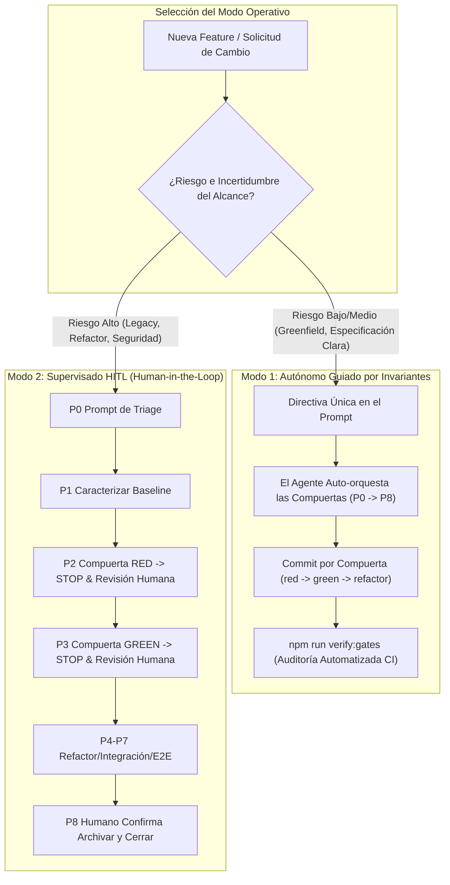

# Manual Operativo y Runbook de Prompts (P0 – P11)

[English](OPERATIONAL_MANUAL.md) | [Español](MANUAL_OPERATIVO.es.md)

> **RayRabbit AI Engineering Standard**  
> *Secuencias de prompts y compuertas operativas para dirigir agentes de codificación de forma determinista.*

---

## 1. Los Dos Modos Operativos de AI Engineering

El arnés de AI Engineering de RayRabbit rechaza la falsa dicotomía entre el "vibe coding" caótico y el micromanagement manual asfixiante. En su lugar, proporciona dos modos operativos deterministas gobernados por las mismas **15 Invariantes de Ingeniería**:



### Modo 1: Autónomo Guiado por Invariantes
* **Cuándo usarlo:** Módulos greenfield (código nuevo), requerimientos bien delimitados, corrección de bugs con reproducción clara e implementación de tareas rutinarias.
* **Cómo funciona:** El operador humano suministra una única directiva de alto nivel (por ejemplo, mediante `/opsx-propose` o un prompt con requerimientos estructurados). Como el contexto del agente incluye `.agent/rules/INVARIANTS.md`, el LLM interioriza las 15 invariantes como salvaguardas cognitivas innegociables. El agente auto-orquesta el ciclo de vida completo de forma desatendida:
  1. Genera los 4 artefactos de OpenSpec (`proposal.md`, `design.md`, `spec.md`, `tasks.md`).
  2. Ejecuta la Fase 2 (RED) y realiza el commit `test(red): <tarea>`.
  3. Ejecuta la Fase 3 (GREEN) y realiza el commit `feat(green): <tarea>`.
  4. Ejecuta Fase 4 (REFACTOR), Fase 5 (INTEGRACIÓN) y Fase 6 (HARDENING).
  5. Valida E2E y ejecuta la sincronización y archivado del cambio.
* **Mecanismo de garantía:** La confianza ciega se reemplaza por auditoría criptográfica. Al terminar, el operador o el CI ejecutan `npm run verify:gates` (o `python scripts/verify_gates.py`). Si el agente omitió la fase roja, mezcló tests con código productivo en un solo commit o bajó la cobertura de 80%, **la compuerta falla y el push queda bloqueado**.

### Modo 2: Supervisado Human-in-the-Loop (HITL)
* **Cuándo usarlo:** Refactorización de código legacy, alta deuda arquitectónica, rutas críticas de seguridad/protocolos, bases de código brownfield no caracterizadas y onboarding de nuevos desarrolladores.
* **Cómo funciona:** El operador humano actúa como copiloto riguroso, guiando al agente a través del **Playbook de Prompts P0 a P11**. El agente tiene la instrucción estricta de detenerse tras cada compuerta (`STOP y repórtame`).
  1. El operador emite **P0 (Triage)** y valida la tabla de enrutamiento.
  2. Si se toca código legacy, emite **P1 (Characterize)** y verifica el commit `@legacy-baseline`.
  3. Emite **P2 (RED)**, valida el fallo legítimo en terminal y revisa el commit `test(red)`.
  4. Aprueba la compuerta roja y emite **P3 (GREEN)**, inspeccionando el diff de implementación mínima.
  5. Recorre secuencialmente desde **P4 (Refactor)** hasta **P8 (Cierre)**.
* **Mecanismo de garantía:** Inspección visual humana en cada frontera de fase complementada por la auditoría automatizada en CI.

---

### Matriz Comparativa de Decisión

| Dimensión | Modo 1: Autónomo Guiado por Invariantes | Modo 2: Supervisado Human-in-the-Loop |
|---|---|---|
| **Esfuerzo Humano** | Mínimo (1 directiva inicial + auditoría final) | Activo (secuencia de prompts guiada P0–P11) |
| **Velocidad de Ejecución** | Alta (ejecución continua multi-fase desatendida) | Deliberada e iterativa (compuertas controladas) |
| **Escenario Ideal** | Features greenfield, herramientas SDK, patrones conocidos | Código brownfield, protocolos core, seguridad |
| **Garantía de Compuertas** | Automatizada vía `verify:gates` y CI `gate-validator.yml` | Inspección humana en tiempo real + CI `verify:gates` |
| **Disparador de Rollback** | Fallo automático en CI o rechazo de `verify:gates` | Intervención humana inmediata ante diffs inesperados |
| **Contexto Necesario** | `.agent/rules/` cargado en el Workspace Activo | `.agent/rules/` cargado + Playbook de Prompts P |

---

## 2. Escalado Híbrido y Transición entre Modos

Ambos modos son 100% interoperables dentro del mismo proyecto y cambio:
* **Escalar a Supervisado (Modo 1 -> Modo 2):** Si un agente en Modo Autónomo se topa con ambigüedad de diseño, viola una invariante o falla el gate E2E tras 3 reintentos, el operador interviene de inmediato con el prompt **P11 (Failure Recovery)** y toma el control en Modo 2 (prompts P paso a paso).
* **Acelerar a Autónomo (Modo 2 -> Modo 1):** Una vez que el operador completa el triage (P0) y congela la línea base del código legacy (P1), puede emitir una directiva única autorizando al agente a auto-ejecutar las fases P2 a P6 bajo las reglas de invariantes.

---

## 3. Matriz de Routing y Triage (R1 – R5)

Al inicio de cualquier tarea, se ejecuta el prompt **P0 (Triage)** para clasificar el alcance:

| Regla | Condición | Flujo Destino | Modo Operativo |
|---|---|---|---|
| **R1 GREENFIELD** | Todos los archivos involucrados son nuevos | `/opsx-apply` + Ciclo TDD Fases 1 a 6 | `--suite` o puro |
| **R2 BUG** | Reporte de defecto sobre funcionalidad existente | `/opsx-bugfix` (Regression-test-first) | `--incremental` |
| **R3 STRANGLE** | Módulo legacy con deuda técnica que se reescribe | `/opsx-strangle` (Test de paridad) | Paralelo / Dual |
| **R4 LEGACY-TOUCH** | Módulo legacy SIN tests de caracterización | `/opsx-characterize` primero y luego `/opsx-apply` | `--incremental` + Legacy-Guard |
| **R5 LEGACY-COVERED** | Módulo legacy YA protegido con tests baseline | `/opsx-apply` directo | `--incremental` + Legacy-Guard |

---

## 4. Secuencia de Prompts Operativos (P0 a P11)

Para el **Modo 2 (Supervisado HITL)** o ejecución de fases específicas, copia y pega estos prompts en tu chat con el agente:

### P0 — Triage
```text
Procede con /opsx-triage sobre el cambio en curso.
Resuelve tú el change o usa openspec list --json.
Devuélveme la tabla de routing (archivo -> nuevo/legacy -> caracterizado? -> deuda técnica) aplicando las reglas R1 a R5, el workflow destino y el modo (--incremental o puro).
PROHIBIDO editar código o tests en este paso.
```

### P1 — Characterize (Congelar Legacy)
```text
Procede con /opsx-characterize sobre los módulos legacy marcados sin baseline en el triage.
Inventaría el comportamiento observable ACTUAL sin modificar código de producción. Crea tests con tag @legacy-baseline y @known-bug:<id>. Ejecútalos en terminal mostrando que son 100% VERDES contra el código intocado. Haz un commit exclusivo "test(baseline): characterization <modulo>".
```

### P2 — Apply + RED (Compuerta RED)
```text
Procede con /opsx-apply sobre el change del triage aplicando estrictamente el skill tdd-workflows-tdd-cycle.
Compuerta Fase 2 (RED): crea primero los tests, ejecútalos en terminal y muéstrame el fallo legítimo antes de tocar producción. La suite @legacy-baseline debe seguir verde. Realiza el commit "test(red): <tarea>". Luego STOP y repórtame.
```

### P3 — GREEN (Implementación Mínima)
```text
Confirmo compuerta RED. Procede con Fase 3 (GREEN) del change en curso.
Implementa el código MÍNIMO estricto para hacer pasar los tests en rojo, sin añadir features extra. Ejecuta la suite completa en terminal: debe estar 100% verde con reporte de cobertura (≥80% líneas / ≥75% ramas). Legacy-guard sobre los módulos caracterizados verificado. Commit "feat(green): <tarea>". Luego STOP y repórtame.
```

### P4 — REFACTOR (Calidad con Suite Verde)
```text
Procede con Fase 4 (REFACTOR) sobre el change en curso.
Aplica principios SOLID, elimina duplicaciones (>3 líneas), descompón métodos (>20 líneas) y reduce complejidad ciclomática (<10). Ejecuta la suite tras CADA modificación asegurando que continúe 100% verde. Refactoriza también los tests sin bajar cobertura. Commit "refactor: <modulo>". STOP y repórtame.
```

### P5 — Integración (Contratos de Módulo)
```text
Procede con Fase 5 (INTEGRATION) sobre el change en curso.
Tests de integración que FALLEN primero modelando la interacción entre componentes y contratos de interfaz. Muestra el fallo legítimo en terminal. Luego implementa la integración mínima hasta pasar la suite completa. Commit "test(integration): <modulo>". STOP y repórtame.
```

### P6 — Hardening (Resiliencia y Revisión)
```text
Procede con Fase 6 (HARDENING) sobre el change en curso.
Añade pruebas de boundary, stress y error recovery según los riesgos del change. Realiza una revisión arquitectónica final. Aplica sugerencias críticas manteniendo verde. Commit "chore(hardening): <modulo>". STOP y repórtame.
```

### P7 — Gate E2E (Runtime Real)
```text
Procede con /opsx-e2e sobre el change en curso.
Ejecuta la suite en runtime real (pytest -m e2e / vitest).
- Verde -> Cierre OK.
- Rojo -> Bucle de autocorrección (máximo 3 reintentos).
- Si supera los 3 intentos o toca seguridad crítica -> STOP y consúltame (HITL).
```

### P8 — Cierre Formal y Sincronización
```text
Cierra el change en curso: /opsx-sync y luego /opsx-archive SOLO si la DoD está completa (suites verdes, cobertura alcanzada, fases 4-6 completas, commits por compuerta verificados). Si algo falla NO archives y avísame.
```

### P9 — Corrección de Defectos (Bugfix)
```text
Procede con /opsx-bugfix sobre el siguiente reporte: [PEGA AQUÍ EL BUG EN LENGUAJE NATURAL].
Test de regresión primero, muestra el fallo legítimo en terminal antes de tocar producción; fix mínimo; suite completa + @legacy-baseline verde; commit "fix: <descripcion>"; métrica escape +1.
```

### P10 — Actualización de Especificación
```text
Procede con /opsx-update sobre el change en curso con esta revisión: [TEXTO LIBRE].
Actualiza proposal.md, design.md y specs/ antes de escribir cualquier código. Confirma los cambios conmigo.
```

### P11 — Failure Recovery (Vuelta a la Calma)
```text
Failure Recovery sobre el change en curso: STOP.
Identifica qué fase se violó, realiza rollback al último commit de compuerta válido (git log --oneline), retoma desde la fase correcta con el prompt correspondiente y documenta la lección aprendida.
```
