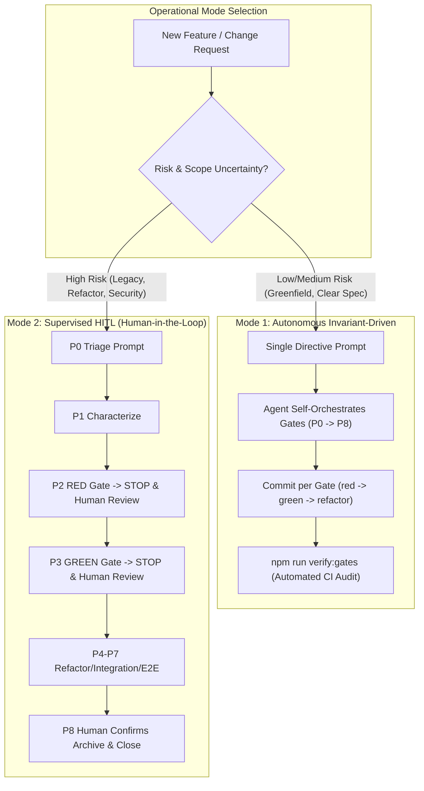

# Operational Manual & Prompt Playbook (P0 – P11)

[English](OPERATIONAL_MANUAL.md) | [Español](MANUAL_OPERATIVO.es.md)

> **RayRabbit AI Engineering Standard**  
> *Deterministic prompt sequences and operational gates for commanding autonomous coding agents.*

---

## 1. The Two Operational Modes of AI Engineering

The RayRabbit AI Engineering harness rejects the false dichotomy between unconstrained "vibe coding" and tedious manual micromanagement. Instead, it provides two deterministic operational modes governed by the same **15 Engineering Invariants**:



### Mode 1: Autonomous Invariant-Driven Mode
* **When to use:** Greenfield modules, well-scoped feature requests, bugfixes with clear replication steps, and routine task implementations.
* **How it works:** The human operator supplies a single high-level directive (e.g., using `/opsx-propose` or an explicit specification prompt). Because the agent's context contains `.agent/rules/INVARIANTS.md`, the LLM internalizes the 15 invariants as non-negotiable cognitive guardrails. The agent autonomously self-orchestrates the entire lifecycle:
  1. Creates the OpenSpec change artifacts (`proposal.md`, `design.md`, `spec.md`, `tasks.md`).
  2. Executes Phase 2 (RED) and creates `test(red): <task>`.
  3. Executes Phase 3 (GREEN) and creates `feat(green): <task>`.
  4. Runs Phase 4 (REFACTOR), Phase 5 (INTEGRATION), and Phase 6 (HARDENING).
  5. Validates E2E and runs sync/archive.
* **Enforcement mechanism:** Trust is replaced by cryptographic audit. At the end of the run, the operator or CI executes `npm run verify:gates` (or `python scripts/verify_gates.py`). If the agent skipped the RED phase, bundled tests and implementation in a single commit, or dropped test coverage below 80%, **the build fails and push is blocked**.

### Mode 2: Supervised Human-in-the-Loop (HITL) Mode
* **When to use:** Legacy code refactoring, high architectural debt, mission-critical security paths, uncharacterized brownfield codebases, and developer onboarding.
* **How it works:** The human operator acts as a rigorous co-pilot, driving the agent through the **P0 to P11 Prompt Playbook**. The agent is explicitly commanded to halt after each gate (`STOP and report`).
  1. The operator issues **P0 (Triage)** and verifies the routing table.
  2. The operator issues **P1 (Characterize)** if legacy code is touched, verifying the `@legacy-baseline` commit.
  3. The operator issues **P2 (RED)**, validates the terminal test failure, and reviews the `test(red)` commit.
  4. The operator confirms the red gate and issues **P3 (GREEN)**, inspecting the implementation diff.
  5. The operator walks through **P4 (Refactor)** to **P8 (Archive)** step-by-step.
* **Enforcement mechanism:** Visual human oversight at each gate boundary supplemented by the same final automated CI validator.

---

### Comparative Decision Matrix

| Dimension | Mode 1: Autonomous Invariant-Driven | Mode 2: Supervised Human-in-the-Loop |
|---|---|---|
| **Human Effort** | Minimal (1 directive prompt + final review) | Active (step-by-step prompt sequence P0–P11) |
| **Pace / Velocity** | High (unattended multi-phase execution) | Deliberate & iterative (controlled gates) |
| **Ideal For** | Greenfield features, isolated SDK tools, known patterns | Brownfield legacy, core protocols, security gates |
| **Gate Enforcement** | Automated via `verify:gates` & CI `gate-validator.yml` | Real-time human inspection + `verify:gates` CI |
| **Rollback Trigger** | Automated failure in CI or `verify:gates` rejection | Immediate human intervention upon unexpected diff |
| **Context Required** | `.agent/rules/` loaded in Active Workspace | `.agent/rules/` loaded + Operator Prompt Playbook |

---

## 2. Hybrid Escalation & Mode Switching

Both modes are 100% interoperable within the same project and change:
* **Escalate to Supervised (Mode 1 -> Mode 2):** If an autonomous agent encounters ambiguity, violates an invariant, or fails an E2E runtime gate after 3 retries, the operator immediately steps in with prompt **P11 (Failure Recovery)** and transitions the session to Mode 2 (step-by-step P prompts).
* **Accelerate to Autonomous (Mode 2 -> Mode 1):** Once an operator completes triage (P0) and freezes the legacy baseline (P1), they may issue a single prompt authorizing the agent to run P2 through P6 autonomously under the invariant rules.

---

## 3. Routing & Triage Matrix (R1 – R5)

At the onset of any task or change, prompt **P0 (Triage)** to classify scope without touching code:

| Rule | Condition | Target Flow | Operational Mode |
|---|---|---|---|
| **R1 GREENFIELD** | All affected files are new | `/opsx-apply` + Full TDD Phases 1 to 6 | `--suite` or pure |
| **R2 BUG** | Defect report against existing behavior | `/opsx-bugfix` (Regression-test-first) | `--incremental` |
| **R3 STRANGLE** | Legacy module with high debt to be rewritten | `/opsx-strangle` (Parity test) | Parallel / Dual |
| **R4 LEGACY-TOUCH** | Legacy module WITHOUT characterization tests | `/opsx-characterize` first, then `/opsx-apply` | `--incremental` + Legacy-Guard |
| **R5 LEGACY-COVERED** | Legacy module ALREADY protected by baseline | `/opsx-apply` direct | `--incremental` + Legacy-Guard |

---

## 4. Operator Prompt Playbook (P0 to P11)

For **Mode 2 (Supervised HITL)** or targeted phase execution, copy and paste these exact prompts into your chat session:

### P0 — Triage
```text
Proceed with /opsx-triage on the active change.
Resolve the change name or query openspec list --json.
Return the routing table (file -> new/legacy -> characterized? -> tech debt) applying rules R1 to R5, target workflow, and mode (--incremental or pure).
STRICTLY FORBIDDEN to edit production code or tests in this step.
```

### P1 — Characterize (Freeze Legacy Baseline)
```text
Proceed with /opsx-characterize on uncharacterized legacy modules identified in triage.
Inventory observable CURRENT behavior without touching production code. Create characterization tests tagged @legacy-baseline and @known-bug:<id>. Run them in terminal proving 100% GREEN against untouched code. Create an isolated commit "test(baseline): characterization <module>".
```

### P2 — Apply + RED (RED Gate)
```text
Proceed with /opsx-apply on the active change strictly applying skill tdd-workflows-tdd-cycle.
Gate Phase 2 (RED): write failing tests first, run in terminal and display legitimate failure before touching production code. The @legacy-baseline suite must remain green. Commit "test(red): <task>". Then STOP and report.
```

### P3 — GREEN (Minimal Implementation)
```text
I confirm the RED gate. Proceed with Phase 3 (GREEN).
Implement the MINIMAL code required to pass failing tests without adding extra speculative features. Run complete suite in terminal: must be 100% green with coverage report (≥80% lines / ≥75% branches). Verify legacy-guard on characterized modules. Commit "feat(green): <task>". Then STOP and report.
```

### P4 — REFACTOR (Quality under Green Suite)
```text
Proceed with Phase 4 (REFACTOR) on the active change.
Apply SOLID principles, remove duplication (>3 lines), decompose long methods (>20 lines), and reduce cyclomatic complexity (<10). Run suite after EVERY edit ensuring it stays 100% green. Refactor tests for clarity without dropping coverage. Commit "refactor: <module>". STOP and report.
```

### P5 — Integration (Module & Contract Tests)
```text
Proceed with Phase 5 (INTEGRATION) on the active change.
Design integration tests that FAIL first modeling component interactions and interface contracts. Display legitimate failure in terminal. Then provide minimal integration logic until full suite is green. Commit "test(integration): <module>". STOP and report.
```

### P6 — Hardening (Resilience & Edge Cases)
```text
Proceed with Phase 6 (HARDENING) on the active change.
Add boundary, stress, and error recovery tests matching change risks. Perform final architectural review against standards. Apply critical suggestions while maintaining green tests. Commit "chore(hardening): <module>". STOP and report.
```

### P7 — Real Runtime Gate (E2E)
```text
Proceed with /opsx-e2e on the active change against live runtime.
Run E2E suite (pytest -m e2e / vitest).
- Green -> Gate passed.
- Red -> Self-correction loop (max 3 retries).
- If retries exceeded or critical security touched -> STOP and escalate to human operator (HITL).
```

### P8 — Formal Close & Sync
```text
Close the active change: run /opsx-sync and then /opsx-archive ONLY if Definition of Done is 100% complete (all suites green, coverage thresholds satisfied, phases 4-6 completed, gate commits audited). If any check fails, do NOT archive.
```

### P9 — Defect Fix (Bugfix Regression-First)
```text
Proceed with /opsx-bugfix on the following defect report: [PASTE NATURAL LANGUAGE DEFECT REPORT].
Write a regression test first, prove legitimate failure in terminal before touching production code; minimal fix; full suite + @legacy-baseline green; commit "fix: <description>"; increment defect escape metric +1.
```

### P10 — Specification Update
```text
Proceed with /opsx-update on the active change with this revision: [FREE TEXT].
Determine if this modifies agreed behavior. Update proposal.md, design.md, and specs/ before writing any code. Confirm changes with me first.
```

### P11 — Failure Recovery
```text
Failure Recovery on the active change: STOP.
Identify which invariant or gate was violated, rollback to the last valid gate commit via git, resume from the correct phase using the corresponding prompt P, and document the lesson learned in change notes.
```
