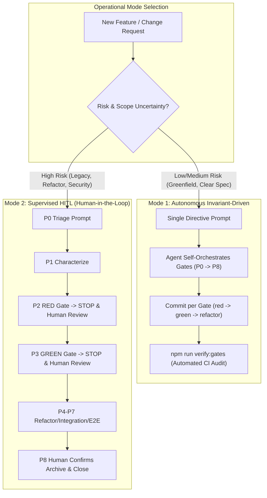

# Operational Manual & Prompt Playbook (P0 – P12)

[English](OPERATIONAL_MANUAL.md) | [Español](MANUAL_OPERATIVO.es.md)

> **RayRabbit AI Engineering Standard**  
> *Deterministic prompt sequences and operational gates for commanding autonomous coding agents.*

---

## 1. The Two Operational Modes of AI Engineering

The RayRabbit AI Engineering harness rejects the false dichotomy between unconstrained "vibe coding" and tedious manual micromanagement. Instead, it provides two deterministic operational modes governed by the same **15 Engineering Invariants**:



### Mode 1: Autonomous Invariant-Driven Mode
* **When to use:** Greenfield modules, well-scoped feature requests, bugfixes with clear replication steps, and routine task implementations.
* **How it works:** The human operator supplies a single high-level directive (e.g., using `/opsx-propose` or an explicit specification prompt). Because the agent's context contains `.agent/rules/INVARIANTS.md`, the LLM internalizes the 15 invariants as non-negotiable cognitive guardrails. The agent autonomously self-orchestrates the entire lifecycle:
  1. Creates the OpenSpec change artifacts (`proposal.md`, `design.md`, `spec.md`, `tasks.md`).
  2. Executes Phase 2 (RED) and creates `test(red): <task>` with scope coupling.
  3. Executes Phase 3 (GREEN) and creates `feat(green): <task>`.
  4. Runs Phase 4 (REFACTOR), Phase 5 (INTEGRATION), and Phase 6 (HARDENING).
  5. Validates E2E and runs sync/archive.
* **Enforcement mechanism:** Trust is replaced by deterministic causal Git audit. At the end of the run, the operator or CI executes `npm run verify:gates` (or `python scripts/verify_gates.py`). If the agent skipped the RED phase, decoupled scopes, bundled tests and implementation in a single commit, or dropped test coverage below 80%, **the build fails and push is blocked**.

### Mode 2: Supervised Human-in-the-Loop (HITL) Mode
* **When to use:** Legacy code refactoring, high architectural debt, mission-critical security paths, uncharacterized brownfield codebases, and developer onboarding.
* **How it works:** The human operator acts as a rigorous co-pilot, driving the agent through the **P0 to P12 Prompt Playbook**. The agent is explicitly commanded to halt after each gate (`STOP and report`).
  1. The operator issues **P0 (Triage)** and verifies the routing table.
  2. The operator issues **P1 (Characterize)** if legacy code is touched, verifying the `@legacy-baseline` commit.
  3. The operator issues **P2 (RED)**, validates the terminal test failure, and reviews the `test(red)` commit.
  4. The operator confirms the red gate and issues **P3 (GREEN)**, inspecting the implementation diff.
  5. The operator walks through **P4 (Refactor)** to **P8 (Archive)** and **P12 (Adversarial Audit)** step-by-step.
* **Enforcement mechanism:** Visual human oversight at each gate boundary supplemented by the same final automated CI validator.

---

### Comparative Decision Matrix

| Dimension | Mode 1: Autonomous Invariant-Driven | Mode 2: Supervised Human-in-the-Loop |
|---|---|---|
| **Human Effort** | Minimal (1 initial prompt + final audit) | Active (guided prompt sequence P0–P12) |
| **Execution Velocity** | High (continuous unattended multi-phase execution) | Deliberate & iterative (controlled gates) |
| **Ideal Scenario** | Greenfield features, SDK tools, standard patterns | Brownfield codebases, core protocols, security |
| **Gate Enforcement** | Automated via `verify:gates` and CI `gate-validator.yml` | Human oversight in real-time + CI `verify:gates` |
| **Rollback Trigger** | Automated CI failure or `verify:gates` rejection | Immediate human intervention upon unexpected diffs |
| **Required Context** | `.agent/rules/` loaded in active workspace | `.agent/rules/` loaded + Prompt Playbook P |

---

## 2. Hybrid Scaling and Mode Transitions

Both modes are 100% interoperable within the same project and change:
* **Escalate to Supervised (Mode 1 -> Mode 2):** If an agent in Autonomous Mode encounters architectural ambiguity, violates an invariant, or fails the E2E gate after 3 retries, the human operator intervenes immediately with prompt **P11 (Failure Recovery)** and assumes control in Mode 2 (step-by-step P prompts).
* **Accelerate to Autonomous (Mode 2 -> Mode 1):** Once the operator finishes triage (P0) and freezes the legacy baseline (P1), they can issue a single directive authorizing the agent to self-execute phases P2 through P6 under the invariants.

---

## 3. Routing & Triage Matrix (R1 – R5)

At the onset of any task, issue prompt **P0 (Triage)** to classify scope:

| Rule | Condition | Target Workflow | Operational Mode |
|---|---|---|---|
| **R1 GREENFIELD** | All affected files are brand new | `/opsx-apply` + TDD Phases 1 to 6 | `--suite` or pure |
| **R2 BUG** | Defect report against existing behavior | `/opsx-bugfix` (Regression-test-first) | `--incremental` |
| **R3 STRANGLE** | Legacy module with high tech debt being rewritten | `/opsx-strangle` (Parity tests) | Parallel / Dual |
| **R4 LEGACY-TOUCH** | Legacy module WITHOUT characterization tests | `/opsx-characterize` first, then `/opsx-apply` | `--incremental` + Legacy-Guard |
| **R5 LEGACY-COVERED** | Legacy module ALREADY protected with baselines | `/opsx-apply` directly | `--incremental` + Legacy-Guard |

---

## 4. Operational Prompt Playbook (P0 to P12)

For **Mode 2 (Supervised HITL)** or running specific phases, copy and paste these prompts into your agent chat:

### P0 — Triage
```text
Proceed with /opsx-triage on the active change.
Resolve the change yourself or run openspec list --json.
Return the routing table (file -> new/legacy -> characterized? -> tech debt) applying rules R1 to R5, target workflow, and mode (--incremental or pure).
FORBIDDEN to edit code or tests during this step.
```

### P1 — Characterize (Freeze Legacy)
```text
Proceed with /opsx-characterize on legacy modules flagged without baselines in triage.
Inventory CURRENT observable behavior without modifying production code. Create tests tagged @legacy-baseline and @known-bug:<id>. Run them in the terminal showing they are 100% GREEN against untouched code. Create an exclusive commit "test(baseline): characterization <module>".
```

### P2 — Apply + RED (RED Gate with Scope Coupling)
```text
Proceed with /opsx-apply on the triaged change strictly applying the tdd-workflows-tdd-cycle skill.
Phase 2 (RED) Gate: write tests first, run them in the terminal, and show legitimate failure before touching production. The @legacy-baseline suite must remain green. Commit "test(red)(<module>): <task>". Then STOP and report.
```

### P3 — GREEN (Minimal Implementation with Scope Matching)
```text
Confirm RED gate. Proceed with Phase 3 (GREEN) of the active change.
Implement MINIMAL code strictly required to pass the red tests without adding extraneous features, matching the test module scope. Run the full test suite in the terminal: must be 100% green with coverage report (≥80% lines / ≥75% branches). Verify legacy-guard on characterized modules. Commit "feat(green)(<module>): <task>". Then STOP and report.
```

### P4 — REFACTOR (Quality Under Green Suite)
```text
Proceed with Phase 4 (REFACTOR) on the active change.
Apply SOLID principles, eliminate duplication (>3 lines), break down methods (>20 lines), and reduce cyclomatic complexity (<10). Run the test suite after EVERY change ensuring it stays 100% green. Refactor test files as well without dropping coverage. Commit "refactor: <module>". STOP and report.
```

### P5 — Integration (Module Contracts)
```text
Proceed with Phase 5 (INTEGRATION) on the active change.
Write integration tests that FAIL first, modeling inter-component interaction and interface contracts. Show legitimate failure in the terminal. Then implement minimal integration glue until the full suite passes. Commit "test(integration): <module>". STOP and report.
```

### P6 — Hardening (Resilience & Audit)
```text
Proceed with Phase 6 (HARDENING) on the active change.
Add boundary, stress, and error recovery tests matching the change risk profile. Perform final architectural review. Address critical suggestions while keeping the suite green. Commit "chore(hardening): <module>". STOP and report.
```

### P7 — Real Runtime E2E Gate
```text
Proceed with /opsx-e2e on the active change.
Run the suite in real live runtime (pytest -m e2e / vitest).
- Green -> Close OK.
- Red -> Self-healing loop (max 3 retries).
- If retries exceed 3 or security critical code is touched -> STOP and escalate (HITL).
```

### P8 — Formal Close & Sync
```text
Close the active change: run /opsx-sync then /opsx-archive ONLY if the DoD is complete (all suites green, coverage thresholds met, phases 4-6 complete, gate commits verified). If anything fails DO NOT archive and alert me.
```

### P9 — Defect Correction (Bugfix)
```text
Proceed with /opsx-bugfix on the following defect report: [PASTE NATURAL LANGUAGE REPORT HERE].
Regression test first, demonstrate legitimate terminal failure before touching production; minimal fix; full suite + @legacy-baseline green; commit "fix(<module>): <description>"; increment escape metric +1.
```

### P10 — Specification Update
```text
Proceed with /opsx-update on the active change with this revision: [FREE TEXT].
Update proposal.md, design.md, and specs/ before writing any code. Confirm changes with me.
```

### P11 — Failure Recovery (Calm Restoration)
```text
Failure Recovery on the active change: STOP.
Identify which phase was violated, rollback to the last valid gate commit (git log --oneline), resume from the correct phase with the appropriate prompt, and document the lesson learned.
```

### P12 — Pre-Push Adversarial Audit
```text
Proceed with /opsx-audit on the branch before pushing or opening a Pull Request.
Execute verify-gates self-tests (Node.js and Python), check working tree status, verify consolidated spec immutability, and ensure zero gate bypasses or production mocks.
```
