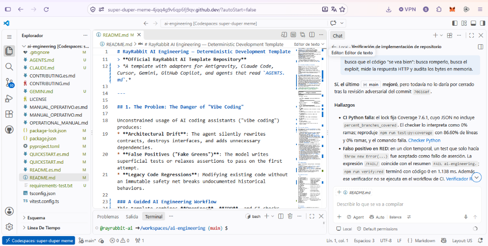

# RayRabbit AI Engineering — Deterministic Development Template

[English](README.md) | [Español](README.es.md)

[](https://openspec.dev)
[](.github/workflows/gate-validator.yml)
[](.agent/rules/INVARIANTS.md)
[](#supported-stacks)
[](LICENSE)

> **Official RayRabbit AI Template Repository**  
> *Deterministic AI engineering harness with CI-enforced Git commit gates. Fuses Spec-Driven Development (OpenSpec) + scope-coupled TDD commit causality + dual-mode autonomy (Invariant vs HITL) to curb "vibe coding" for Antigravity, Cursor, Claude Code and more. Polyglot (TS/Python).*

---

## 1. The Problem: The Danger of "Vibe Coding"

Unconstrained usage of AI coding assistants ("vibe coding") produces:
* **Architectural Drift**: The agent silently rewrites contracts, destroys interfaces, and adds unnecessary dependencies.
* **False Positives ("Fake Greens")**: The model writes superficial tests or relaxes assertions to pass on the first attempt.
* **Legacy Code Regressions**: Modifying existing code without an immutable safety net breaks undocumented historical behaviors.

### The Solution: Deterministic AI Engineering
This template fuses **Spec-Driven Development (OpenSpec)** with **Strict Test-Driven Development (TDD)** and **CI-Enforced Causal Git Commit Gates**:
1. **Zero code without prior approved specification** (`openspec/specs/`).
2. **Zero production code without a verified failing test (`test(red)`) with scope/module coupling and strict isolation**:
   - Production files are strictly forbidden in `test(red):` commits.
   - At least one legitimate test file is mandatory.
   - Physical non-zero exit code failure can be asserted via `npm run verify:red` / `npm run verify:red:py`.
3. **Physical merge blocking in CI via Branch Protection**: Pull Requests cannot be merged if they violate TDD commit causality, baseline immutability, or coverage thresholds (see [`docs/BRANCH_PROTECTION.md`](docs/BRANCH_PROTECTION.md)).
4. **Hardened against CWE-78 & Tampering**: All Git operations use direct process spawning with strict reference format validation (`git check-ref-format`); `.github/CODEOWNERS` prevents untrusted PRs from weakening the gates.
5. **Physical Historical Replay of RED Commits in CI**: Every `test(red)` commit is mechanically replayed against its parent commit `<sha>^` in an isolated `git worktree` to verify physical `AssertionError` failures, actively rejecting premature green tests and syntax errors ([`verify-historical-replay.mjs`](scripts/verify-historical-replay.mjs)).
6. **Mechanical OpenSpec Change Linkage**: All production commits (`feat(green)` and `fix`) require active OpenSpec Change metadata (`OpenSpec-Change:` trailer or composite scope), ensuring end-to-end SDD traceability.
7. **Developer Ergonomics TDD CLI**: High-velocity CLI helpers (`npm run tdd:red`, `npm run tdd:green`, `npm run tdd:refactor` via [`tdd-flow.mjs`](scripts/tdd-flow.mjs)) automate test verification, scope deduction, and commit construction.
8. **Built-in Adversarial Audit & Guard**: Pre-push and CI enforcement via [`guard-agent`](scripts/guard-agent.mjs), [`adversarial_auditor`](.agent/rules/ADVERSARIAL_AUDITOR.md), and [`/opsx-audit`](.agent/workflows/opsx-audit.md).

> 🔬 **Empirical Evidence & Hostile AI Auditing**: Read our [Live A/B Benchmark Case Study](./docs/ab-testing-and-coverage.md) documenting how an unconstrained agent falls into the *"TDD Illusion"* and gets blocked by the CI gate validator.
>
> 📸 **Battle-Tested Under Live Adversarial Stress**: Rather than relying on theoretical claims, this template was subjected to live adversarial stress-testing in GitHub Codespaces by frontline AI models (GitHub Copilot / GPT-6 Luna) prompted to actively exploit edge cases and break gates. Every nuance was physically remediated, verified, and sealed with 0 open vulnerabilities (see [Full Audit Dossier](./docs/audit/README.md)).
>
> <p align="center">
>   
> </p>

```
┌─────────────────────────────────────────────────────────────────────────────┐
│                    DETERMINISTIC AI ENGINEERING PIPELINE                    │
└─────────────────────────────────────────────────────────────────────────────┘

  Requirement / Bug Report
          │
          ▼
   [ P0. TRIAGE ] ────────────► Classification R1–R5 (New vs Legacy)
          │
    ┌─────┴─────────────────────────────────┐
    │ Greenfield                            │ Legacy Detected
    ▼                                       ▼
 [ SDD: Spec + Proposal ]            [ P1. CHARACTERIZE ]
    │                                       │ (Golden Master / @legacy-baseline)
    ▼                                       ▼
 [ P2. RED ] ◄──────────────────────────────┘
    │ (Test fails legitimately in terminal. Assert with verify:red. Commit: test(red))
    ▼
 [ P3. GREEN ]
    │ (MINIMAL implementation. Commit: feat(green) + Coverage ≥80% Lines / ≥75% Branches)
    ▼
 [ P4. REFACTOR ]
    │ (SOLID, Complexity <10, Methods <20L. Commit: refactor)
    ▼
 [ P5. INTEGRATION ]
    │ (Interface contracts. Fail-first. Commit: test(integration))
    ▼
 [ P6. HARDENING ]
    │ (Edge cases & stress. Commit: chore(hardening))
    ▼
 [ P7. GATE E2E ]
    │ (Real runtime live tests. Max 3 retries -> HITL)
    ▼
 [ P8. CLOSE & ARCHIVE ]
    │ (Sync Specs + Archive Change)
    ▼
  GitHub PR (Physically enforced via .github/workflows/gate-validator.yml + Branch Protection)
```

---

## 2. The 15 Universal Invariants

Any coding agent operating in this repository must strictly adhere to the rules codified in [`.agent/rules/INVARIANTS.md`](.agent/rules/INVARIANTS.md):

* **Automated CI & Commit Gates** (Mechanically verified on every PR and commit):
  1. **Commit per Gate & Scope Coupling**: Atomic independent commits (`RED`, `GREEN`, `REFACTOR`, `BASELINE`, `FIX`). Every production file modified in `feat(green)` must be coupled to an active `test(red)` scope. Universal wildcards are strictly rejected.
  2. **Immutable Baseline**: Tests tagged `@legacy-baseline` are never modified without explicit `test(baseline): update`.
  3. **Isolation & Test Mandatory in RED**: Production files are strictly forbidden in `test(red)`, and at least one real test file must be changed (local verification via `npm run verify:red`).
  4. **Coverage per Phase**: Lines ≥ 80%, Branches ≥ 75% mechanically checked in CI independently for TS and Python.
  6. **Continuous Legacy-Guard**: Characterization suite must remain 100% green on every step.
  - **OpenSpec Spec Immutability**: Direct tampering with consolidated `openspec/specs/` is blocked.

* **Autonomous Agent Playbook & Protocol** (Enforced by Agent DNA & workflows):
  5. **Mandatory Refactoring Triggers**: Complexity > 10, Method > 20 lines, Class > 200 lines, Duplication > 3 lines.
  7. **Formal DoD Gate**: Closed changes require completed phases 1 to 6, green suites, and synced specs.
  8. **Hard Anti-Pattern Prohibitions**: Zero code before tests, zero assertion relaxation, zero ignored test failures.
  9. **Incremental Mode by Default**: Step-by-step progress (`--incremental`) when facing legacy or uncertainty.
  10. **Deterministic Failure Recovery**: Immediate STOP upon invariant violation, rollback to the last valid gate commit.
  11. **Config Precedence over Refactor**: Architectural wire invariants take precedence over cosmetic refactoring.
  12. **Suite Separation by Markers**: `unit`, `integration`, `legacy-baseline`, `e2e`.
  13. **Zero Warning Tolerance on Archive**: Incomplete artifacts or pending tasks strictly block archiving.
  14. **Pre-Code Contract Gate**: API or security changes require approved spec deltas before touching code.
  15. **Real Runtime E2E Gate & HITL**: Real runtime test execution in CI (`pytest -m e2e`); retry limits (max 3 retries) and human escalation operate as agent workflow policy.

---

## 3. Supported Stacks

| Stack | Testing Engine | Coverage Provider | CI Enforcement Status |
|---|---|---|---|
| **TypeScript / Node.js** | Vitest (`tests/ts/`) | `@vitest/coverage-v8` (Lines ≥80%, Branches ≥75%) | Full CI suite + commit gate validator (`verify-gates.mjs`) |
| **Python** | Pytest (`tests/`) | `pytest-cov` + `check_python_coverage.py` (Lines ≥80%, Branches ≥75% independent check) | Full CI suite + commit gate validator (`verify_gates.py`) |
| **Others (Go, Rust, Java)** | Native runners | Standard toolchain | Commit gates validator is polyglot; plug in your test runner in CI |

---

## 4. Multi-Agent Native Configuration

This repository includes native root rule entrypoints so AI coding assistants load the invariants automatically:

* **Google Antigravity & Gemini**: [`GEMINI.md`](./GEMINI.md)
* **Claude Code**: [`CLAUDE.md`](./CLAUDE.md)
* **Cursor IDE**: [`.cursorrules`](./.cursorrules) and [`.cursor/rules/ai-engineering.mdc`](./.cursor/rules/ai-engineering.mdc)
* **Windsurf / Cascade**: [`.windsurfrules`](./.windsurfrules)
* **Universal Agents**: [`.agent/rules/AGENTS.md`](./.agent/rules/AGENTS.md) and [`.agent/rules/INVARIANTS.md`](./.agent/rules/INVARIANTS.md)

---

## 5. Repository Structure

```text
.
├── .github/
│   ├── CODEOWNERS               # Gate protection against untrusted PR modification
│   └── workflows/
│       ├── gate-validator.yml   # PR & push gatekeeper: verifies causality, range & coverage
│       └── validate-specs.yml   # OpenSpec schema validator
├── .agent/                      # Context & workflows for Antigravity, Cursor, Claude Code
│   ├── rules/                   # 15 Invariants, Pre-Code Gate & Agent DNA
│   ├── skills/                  # Runnable skills (TDD cycle, OpenSpec)
│   └── workflows/               # Orchestration workflows (/opsx-triage, /opsx-apply...)
├── CLAUDE.md                    # Claude Code automatic configuration
├── GEMINI.md                    # Google Antigravity & Gemini automatic configuration
├── .cursorrules                 # Cursor IDE automatic configuration
├── .windsurfrules               # Windsurf Cascade automatic configuration
├── openspec/                    # Spec-driven engine
│   ├── config.yaml
│   ├── specs/                   # Living specifications
│   └── changes/                 # Active changes (proposal, design, tasks)
├── scripts/
│   ├── verify-gates.mjs         # Hardened Node.js commit gate auditor (CWE-78 immune)
│   ├── verify_gates.py          # Hardened Python commit gate auditor (CWE-78 immune)
│   ├── verify-historical-replay.mjs # Physical RED test failure replay in CI (git worktree)
│   ├── verify-red-failure.mjs   # Physical verification of RED failure (Node.js)
│   ├── verify_red_failure.py    # Physical verification of RED failure (Python)
│   ├── check_python_coverage.py # Independent Line & Branch coverage verifier
│   ├── tdd-flow.mjs             # Developer ergonomics CLI (tdd:red, tdd:green, tdd:refactor)
│   ├── redteam-audit.mjs        # 10-domain automated adversarial red team engine
│   ├── guard-agent.mjs          # Semantic and structural contract guardian
│   ├── setup_branch_protection.py # Automated GitHub branch protection setup
│   └── setup-branch-protection.sh # Bash setup script for branch protection
├── src/                         # Production code (TypeScript & Python examples)
├── tests/                       # Structured suites (unit, integration, characterization, e2e)
├── docs/                        # A/B Testing, Branch Protection & Architecture guides
├── package.json
└── pyproject.toml
```

---

## 6. Quickstart

See [`QUICKSTART.md`](./QUICKSTART.md) to get started in 3 minutes.

```bash
# 1. Clone the template
git clone https://github.com/rayrabbit-ai/ai-engineering.git my-project
cd my-project

# 2. Install pinned dependencies (Node & Python)
npm ci
python -m pip install -r requirements-test.txt
python -m pip install --no-deps --no-build-isolation -e .

# 3. Enable physical branch protection on GitHub (1 command)
npm run setup:branch-protection

# 4. Developer Ergonomics TDD Commands
npm run tdd:red -- "add multiplication operator"       # Verify failure & commit test(red)
npm run tdd:green -- "implement multiplication"        # Verify pass, coverage & commit feat(green)
npm run tdd:refactor -- "optimize arithmetic algorithm" # Verify regression-free & commit refactor

# 5. Audit commit gates at any time
npm run verify:gates

# 6. Verify historical replay of RED commits locally or in CI
npm run verify:replay:self-test

# 7. Run tests with separate line & branch coverage
npm run test:ts:coverage     # TypeScript
npm run test:py:coverage     # Python

# 8. Execute full automated 10-domain adversarial red team audit
npm run audit:redteam
```

---

## 7. Additional Documentation
* [Security & Adversarial Audit Dossier](./docs/audit/README.md)
* [GitHub Branch Protection & Physical Merge Blocking](./docs/BRANCH_PROTECTION.md)
* [Empirical A/B Benchmark Case Study & Coverage Guide](./docs/ab-testing-and-coverage.md)
* [Operational Manual and Prompt Sequences (P0 - P11)](./OPERATIONAL_MANUAL.md)

* [The 15 Universal Invariants](.agent/rules/INVARIANTS.md)
* [Pre-Code SDD Gate](.agent/rules/SDD_GATE.md)
