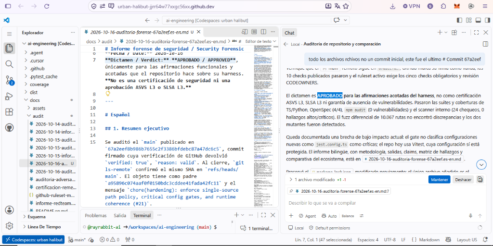

# RayRabbit AI Engineering — Expediente de Auditorías y Línea de Tiempo Forense

[English](README.en.md) | [Español](README.md)

[](2026-10-16-auditoria-forense-67a2eef.es-en.md)
[](2026-10-16-auditoria-adversarial-hostil.es.md)
[](github-ruleset-main.json)
[](https://github.com/rayrabbit-ai/ai-engineering/commit/67a2eef8b986b7655c2f3386bfdebc87a47dc6c5)

Este directorio documenta la trazabilidad completa, las evaluaciones forenses adversariales e independientes y la línea de tiempo de mejora continua entre nuestro validador subagente (`adversarial_auditor`) y el modelo de frontera de GitHub (**GPT-6 Luna** en Codespaces) sobre el repositorio [rayrabbit-ai/ai-engineering](https://github.com/rayrabbit-ai/ai-engineering).

---

## 🏆 Veredicto Oficial y Evidencia en Vivo (Commit `67a2eef`)

> ### **Dictamen de GitHub GPT-6 Luna en Codespaces:** **APROBADO / APPROVED**
> *"Los cinco checks de protección obligatorios están configurados en un ruleset activo y todos los diez checks que devolvió la API para el SHA terminaron en success. Los self-tests del harness, la coherencia política/runtime, OpenSpec, el build, las suites TypeScript y Python, las coberturas, E2E, npm audit y el scanner interno pasaron en las pruebas reproducibles. Dos mutaciones dirigidas fueron detectadas y un fuzz diferencial de 10.067 rutas produjo cero discrepancias entre Node y Python."*  
> — [Informe Forense Independiente de Seguridad (2026-10-16)](2026-10-16-auditoria-forense-67a2eef.es-en.md)

<p align="center">
  
</p>

---

## ⏱️ Línea de Tiempo de Iteración y Mejora Continua (PR #18 a PR #21)

La siguiente cronología detalla los ciclos de ataque adversarial, detección de fisuras, remediación profunda de raíz y validación cruzada hasta obtener el dictamen aprobatorio:

```
┌─────────────────────────────────────────────────────────────────────────────────────────────────┐
│                      LÍNEA DE TIEMPO FORENSE: SUBAGENTE vs GPT-6 LUNA                           │
└─────────────────────────────────────────────────────────────────────────────────────────────────┘

  [PR #18] (Commit a95896c) ──► GPT-6 Luna: RECHAZADO (F-01 a F-05, C1–C6)
       │                        └─ Causa: 5 implementaciones divergentes de rutas y config en docs:
       ▼
  [PR #19] (Hardening #19)  ──► Subagente: Umbrales anidados Vitest 5.0.4 + Python coverage fail-closed
       │                        └─ Cierre de fallos de reporte y delimitadores de CLI
       ▼
  [PR #20] (Hardening #20)  ──► Subagente: Escáner Red Team de 8 a 18 probes con inyección activa
       │                        └─ Worktrees aislados y mitigación F-NEW-01 a F-NEW-05
       ▼
  [PR #21] (Commit 67a2eef) ──► REMEDIACIÓN DE RAÍZ: Single-Source Path Policy + Coherencia Runtime
       │                        ├─ Subagente adversarial_auditor: APROBADO (17 controles, 24 probes)
       │                        └─ GitHub GPT-6 Luna en Codespaces: APROBADO / APPROVED (10/10 checks)
       ▼
  [PRÓXIMO HITO] ───────────► INGENIERÍA DE SEGURIDAD FORMAL (OWASP, CWE, SLSA, MITRE)
                                └─ Guía de inspección LLM atribuible a certificaciones formales
```

### Tabla Comparativa de Ciclos de Iteración

| PR / Commit | Validador / Auditor | Foco de la Prueba | Veredicto | Hallazgos y Remediación |
| :--- | :--- | :--- | :---: | :--- |
| **PR #18**<br>`a95896c` | **GitHub GPT-6 Luna**<br>(Codespaces Ola 3) | Evaluación forense de compuertas, clasificación de archivos y orden de CI. | **RECHAZADO** | **F-01:** Código bajo `src/tests/` clasificado erróneamente como test.<br>**F-02:** Configuración crítica modificable bajo `docs:`.<br>**R-03:** `npm ci` ejecutado antes de validar integridad de compuertas. |
| **PR #19**<br>`#19` | **Subagente `adversarial_auditor`** | Umbrales de cobertura en Vitest 5 y validación estricta en Python. | **GREEN (CI)** | Remediación de bloques anidados `coverage.thresholds` para Vitest 5.0.4, parser fail-closed de cobertura en Python y delimitadores CLI. |
| **PR #20**<br>`#20` | **Subagente `adversarial_auditor`** | Inyección activa de fallos, canal lateral y replay en worktrees. | **GREEN (CI)** | Ampliación del escáner Red Team de 8 a 18 probes con canarios en subprocesos, resolución de hallazgos F-NEW-01 a F-NEW-05 y aislamiento de dependencias. |
| **PR #21**<br>[`67a2eef`](https://github.com/rayrabbit-ai/ai-engineering/commit/67a2eef8b986b7655c2f3386bfdebc87a47dc6c5) | **Subagente `adversarial_auditor`** &<br>**GitHub GPT-6 Luna** | Remediación de raíz arquitectónica: Single-Source Policy, coherencia runtime y vectores C1–C6. | **APROBADO**<br>**(APPROVED)** | **Remediación Total:**<br>1. SSoT: [`scripts/path-policy.json`](../../scripts/path-policy.json) y 67 fixtures compartidos.<br>2. Coherencia: [`scripts/verify-policy-coherence.mjs`](../../scripts/verify-policy-coherence.mjs) (invariantes I1–I5).<br>3. Vectores C1–C6: `-z` null byte (C1), rechazo de merges (C2), modos symlink/submódulo `120000`/`160000` (C3), zona `src/` productiva (C4), scripts `.ps1`/`.bat`/`.sql` (C5), configs `Dockerfile`/`Makefile` (C6).<br>4. Aislamiento `pool: 'vmThreads'` en Vitest. |

---

## 🎯 Próximo Hito: Hacia la Ingeniería de Seguridad Formal

> [!IMPORTANT]
> **OBJETIVO ESTRATÉGICO DEL PRÓXIMO HITO:**
> Evolucionar el arnés determinista de RayRabbit AI Engineering para incorporar los marcos de **Ingeniería de Seguridad (OWASP ASVS L3, OWASP LLM Top 10, CWE Top 25, SLSA L3 y MITRE ATT&CK/ATLAS)** como **guía formal de inspección ejecutable por el agente LLM**, avanzando hacia la capacidad de **atribuir y sustentar certificaciones formales verificables**.

### Metas Técnicas Concretas del Próximo Hito

1. **Extensibilidad de Configuración Crítica (Cierre F-01 de Luna):**
   - Ampliar `criticalConfigPatterns` en `path-policy.json` y el verificador de coherencia para bloquear automáticamente alteraciones en runners y herramientas emergentes (`jest.config.*`, `playwright.config.*`, `vite.config.*`, `eslint.config.*`, `webpack.config.*`), fallando de forma cerrada ante herramientas no contempladas.
2. **Provenance y Cadena de Suministro SLSA L3:**
   - Incorporar generación criptográfica de Provenance en releases mediante `slsa-github-generator` y attestations verificables (in-toto/Witness) con hashes digest de artefactos.
3. **Auditoría de Supply Chain Políglota:**
   - Añadir `pip-audit` con instalación de dependencias bloqueadas mediante hashes (`--require-hashes`), garantizando paridad total con `npm audit`.
4. **Matriz de Conformidad Formal ASVS / OWASP LLM:**
   - Desarrollar la matriz de trazabilidad formal mapeando cada control técnico del arnés contra requisitos normativos específicos, sirviendo como guía de auto-inspección pre-commit para asistentes de código (Antigravity, Cursor, Claude Code).

---

## 📂 Expediente Histórico y Vigente de Auditorías

| Fecha | Documento | Tipo / Emisor | Dictamen / Estado |
| :--- | :--- | :--- | :--- |
| **2026-10-16** | [**Auditoría Forense Independiente (Ola 4 — `67a2eef`)**](2026-10-16-auditoria-forense-67a2eef.es-en.md) | **Externa (GitHub Copilot GPT-6 Luna en Codespaces)** | **APROBADO / APPROVED** (Vigente) |
| **2026-10-16** | [**Auditoría Forense Hostil Interna**](2026-10-16-auditoria-adversarial-hostil.es.md) | **Interna (Subagente `adversarial_auditor`)** | **APROBADO** (Vigente — 17/17 controles, 24 probes) |
| 2026-10-16 | [Auditoría forense independiente (Ola 3 — `a95896c`)](2026-10-16-auditoria-forense-a95896c.es.md) | Externa (Copilot GPT-6 Luna): F-01 rutas, F-02 config, R-03 orden CI | Histórico (100% remediado en PR #21 / `67a2eef`) |
| 2026-10-16 | [Informe del escáner heurístico](informe-redteam.es.md) | Automático (`redteam-audit.mjs`, 24 chequeos) | Vigente |
| 2026-10-15 | [Snapshot autenticado de GitHub Ruleset](github-ruleset-main.json) | Captura JSON verificable del Ruleset activo en `main` (`id: 25150565`) | Vigente |
| 2026-10-15 | [Auditoría forense independiente (Ola 2 — `ed6a4c3`)](2026-10-15-auditoria-forense-ai-engineering.es.md) | Externa: confirmó 5/5 checks y señaló `F-01` (`guard`) y `F-02` (`redteam`) | Histórico (remediado en `a95896c`) |
| 2026-10-15 | [Informe forense independiente (Ola 1)](2026-10-15-informe-forense-independiente.es.md) | Externa: verificación de replay, cobertura y saneamiento de claims | Histórico (remediado en `ed6a4c3`) |
| 2026-10-15 | [Certificación de remediación](certificacion-remediacion-final.es.md) | Interna previa; superada por las auditorías independientes | Superado |
| 2026-10-15 | [Auditoría Forense Adversarial Externa](2026-10-15-auditoria-forense-adversarial.es.md) | Externa (causalidad y replay) | Histórico |
| 2026-10-15 | [Auditoría adversarial interna](auditoria-adversarial-forense-asvs-l3.es.md) | Interna (no es certificación formal) | Histórico |
| 2026-10-14 | [Informe de Correcciones](2026-10-14-informe-correcciones.es.md) | Remediación fase 1 | Histórico |
| 2026-10-14 | [Auditoría Técnica Externa](2026-10-14-auditoria-externa-copilot-luna.es.md) | Externa (claims y bypasses iniciales) | Histórico |

---

## ⚖️ Alcance: Qué Es y Qué No Es

**Sí es:** Una plantilla y arnés de ingeniería determinista para desarrollo asistido por IA (SDD + TDD estricto) con compuertas causales verificadas por Git y CI, fuente única de verdad para políticas de rutas (`scripts/path-policy.json`), motor de coherencia runtime (`verify-policy-coherence.mjs`), guardián semántico de contratos (`guard-agent.mjs`), suites y coberturas políglotas independientes (TypeScript y Python), y bloqueo físico en GitHub mediante Ruleset activo.

**No es:**
- Una certificación regulatoria externa (ASVS L3 o SLSA L3).
- Un compilador con análisis de flujo de datos (taint analysis) en profundidad.
- Un servicio HTTP con memoria sensible desplegado en producción.

---

## 🔍 Reproducibilidad y Verificación Independiente

Cualquier operador o auditor independiente puede reproducir exactamente los 17 controles mecánicos ejecutando:

```bash
# Guardián estructural y semántico de contratos + self-test adversarial
node scripts/guard-agent.mjs
npm run verify:guard:self-test

# Coherencia estricta entre política de rutas y runtime real
npm run verify:policy
npm run verify:policy:self-test

# Auto-verificación de compuertas (TypeScript y Python)
npm run verify:gates:self-test
npm run verify:gates:py:self-test

# Auto-verificación de ejecutores RED anti-inyección
npm run verify:red:self-test
npm run verify:red:py:self-test

# Verificación de Replay Histórico Físico de Commits RED en CI
npm run verify:replay:self-test

# Verificación de Ergonomía CLI TDD
npm run tdd:flow:self-test

# Cobertura estricta e independiente (Líneas >=80%, Ramas >=75%)
npm run test:ts:coverage
npm run test:py:coverage

# Pruebas End-to-End en runtime real
npm run test:ts:e2e
pytest -m e2e --tb=short

# Validación de especificaciones OpenSpec
npm run spec:validate

# Escáner heurístico interno de seguridad y contratos (24 probes)
npm run audit:redteam
```
