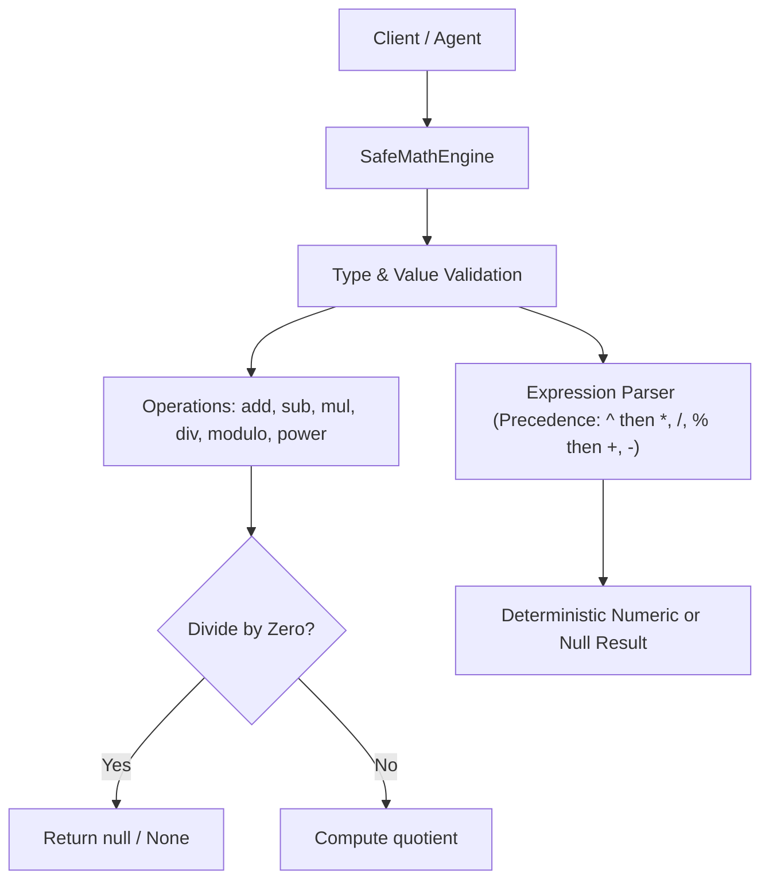

# Technical Design: Extend Math Engine with Modulo, Power, and Safe Zero Division

## Context
Extending `SafeMathEngine` in both TypeScript (`src/calculator.ts`) and Python (`src/calculator.py`) to support modulo (`%`) and exponentiation (`^`), and updating division semantics so division by zero returns `null` / `None`.

## Architecture & Data Flow

## Goals / Non-Goals

**Goals:**
- Add `modulo(a, b)`: returns `a % b`. When `b === 0`, returns `null` / `None`.
- Add `power(a, b)`: returns `a ** b`.
- Modify `divide(a, b)`: when `b === 0`, returns `null` / `None` without throwing.
- Support `^` and `%` in `evaluateSimple` / `evaluate_simple`, evaluating `^` first, then `*`, `/`, `%`, then `+`, `-`.
- Maintain strict type validation (`TypeError` for non-numbers).
- Parity between TypeScript and Python.

**Non-Goals:**
- Arbitrary code execution or complex math functions (trigonometry, logarithms).
- Complex imaginary numbers.

## Interfaces & Error Handling

- TypeScript:
  - `divide(a: MathNumber, b: MathNumber): MathNumber | null`
  - `modulo(a: MathNumber, b: MathNumber): MathNumber | null`
  - `power(a: MathNumber, b: MathNumber): MathNumber`
  - `evaluateSimple(expr: string): MathNumber | null`
- Python:
  - `divide(self, a: Number, b: Number) -> Optional[float]`
  - `modulo(self, a: Number, b: Number) -> Optional[Number]`
  - `power(self, a: Number, b: Number) -> Number`
  - `evaluate_simple(self, expr: str) -> Optional[Number]`
