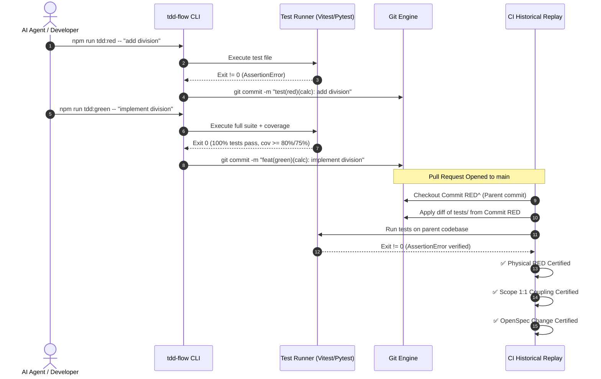

## Context

An external adversarial forensic audit revealed three concrete security and causality gaps in `rayrabbit-ai/ai-engineering`:
1. `pModule.endsWith('/' + activeScope)` allowed cross-directory scope hijacking (`auth` authorized `billing/auth`).
2. GitHub Actions tested only the self-tests of `verify-red-failure`, never physically executing RED tests against parent commits in a PR to confirm legitimate assertion failure.
3. OpenSpec validation verified Markdown syntax, but had no mechanical check binding production code commits to active Change IDs.

## Goals / Non-Goals

**Goals:**
- Eliminate scope suffix collision completely via 1:1 canonical hierarchical module mapping.
- Implement an automated Historical Replay engine in CI that checks out the parent commit of every `test(red)` commit and physically proves that the introduced test failed due to an assertion failure.
- Enforce mechanical OpenSpec Change linkage on all `feat(green)` and `fix` commits.
- Provide high-ergonomics developer CLI commands (`npm run tdd:red`, `npm run tdd:green`, `npm run tdd:refactor`) that manage failure assertion, test runs, coverage gating, and commit syntax automatically.
- Realign repository documentation and public claims with audited realities.

**Non-Goals:**
- Cloud-hosted SaaS orchestrators or external server dependencies. Everything must remain 100% Git-native, local-first, and CI-executable via standard runners.
- Modifying the underlying business logic of `src/calculator.ts` or `src/calculator.py`.

## Architecture & Workflows

## Decisions

### 1. Canonical 1:1 Module Identity vs Suffix Heuristics
- **Choice**: Enforce exact equality `activeRedScopes.has(pModule)`.
- **Rationale**: Any suffix or substring matching (e.g. `endsWith('/' + scope)`) inevitably creates cross-directory collisions in modular repositories (e.g. `ui/button` vs `checkout/button`, or `auth` vs `billing/auth`). Exact equality forces tests to reside in matching paths (e.g. `tests/billing/test_auth.py` for `src/billing/auth.py`) or declare explicit scopes in commit subjects (`test(red)(billing/auth): ...`).

### 2. Physical Historical Replay via `git worktree` in CI
- **Choice**: Create an isolated temporary git worktree or detachment to replay RED commits.
- **Rationale**: Modifying the working tree in-place during CI can pollute subsequent jobs if not cleanly restored. Using `git worktree add ../replay-sandbox <sha>^` ensures zero state pollution on the runner, isolates test runner execution, and guarantees clean teardown.

### 3. OpenSpec Change Linkage via Scopes and Git Trailers
- **Choice**: Accept OpenSpec Change identification via either subject scope `feat(green)(<change>/<module>): ...` or standard Git Trailer `OpenSpec-Change: <change>`.
- **Rationale**: Preserves commit readability while providing machine-parseable metadata for CI verification against `openspec/changes/<change>/tasks.md`.

### 4. Developer Ergonomics Wrapper (`scripts/tdd-flow.mjs`)
- **Choice**: Implement a zero-dependency Node.js CLI script invoked via `npm run tdd:red`, `npm run tdd:green`, and `npm run tdd:refactor`.
- **Rationale**: Eliminates developer frustration with git syntax errors, dirty tree exceptions, and manual scope calculations, turning the strict 15 Invariants into an effortless, guided experience for both human engineers and AI coding assistants.

## Risks / Trade-offs

- **[Risk] Slower CI execution due to multiple test runner invocations during replay**  
  → *Mitigation*: Only execute the specific test files introduced in the `test(red)` commit rather than the entire test suite during the historical replay step.
- **[Risk] Test runners failing on missing production files instead of assertion errors**  
  → *Mitigation*: The replay verifier explicitly checks stderr and test failure output for `AssertionError`, `expect()`, or test framework failure indicators, distinguishing legitimate test failures from `ModuleNotFoundError` or syntax compilation errors.
