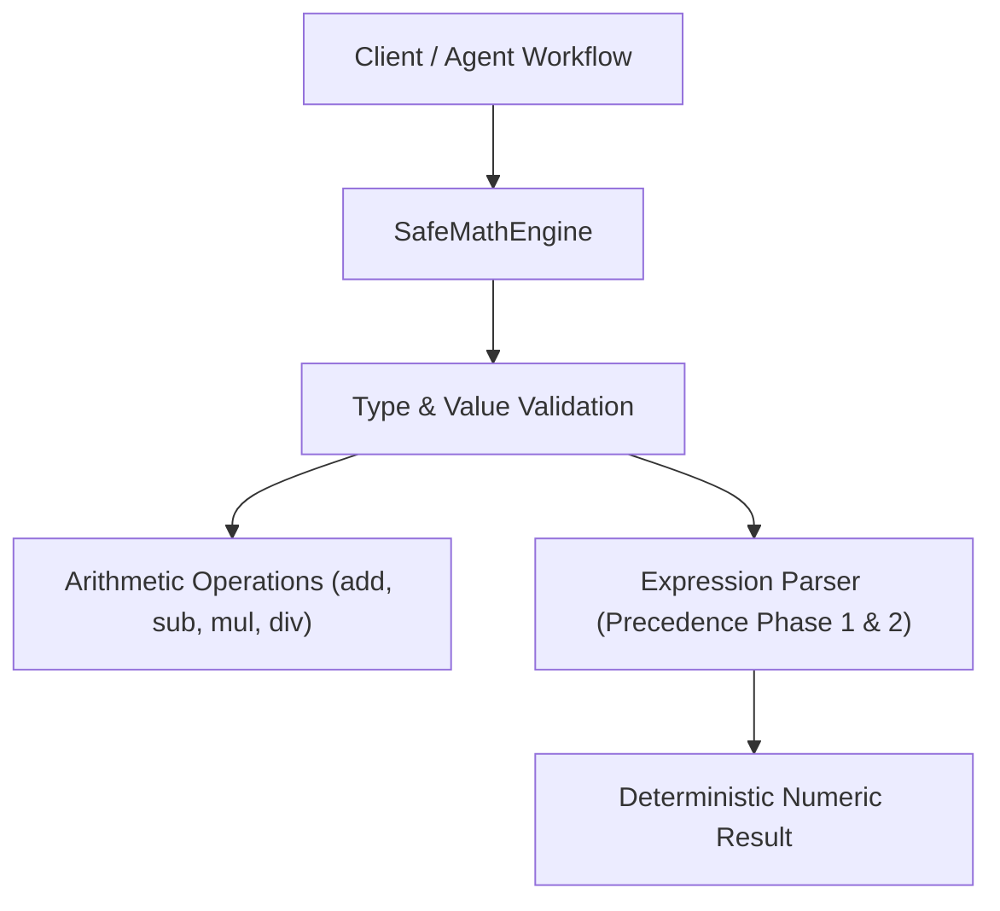

# Technical Design: Safe Math Engine

## Context
This component establishes the foundational deterministic calculation engine for the RayRabbit AI Engineering template. It must work identically across both TypeScript and Python, demonstrating zero-mock functional code and strict testability.

## Architecture & Data Flow

## Goals / Non-Goals

**Goals:**
- Provide pure, isolated, side-effect-free arithmetic methods.
- Implement an AST-like precedence evaluation without executing unsafe JavaScript/Python `eval()`.
- Maintain 100% parity across TypeScript (`src/calculator.ts`) and Python (`src/calculator.py`).
- Provide fast unit testing (< 5ms) and characterization tests for legacy baseline.

**Non-Goals:**
- Scientific calculus, trigonometric functions, or symbolic math (out of scope for v1).
- Multi-threaded asynchronous distributed calculation.

## Decisions

### 1. Two-Phase Sequential Token Evaluation over Abstract Syntax Tree
- **Rationale**: An AST library adds external dependencies. A two-pass token reducer (Multiplication first, Addition/Subtraction second) provides $O(n)$ precedence evaluation with zero third-party dependencies.
- **Alternatives considered**: `mathjs` (too heavy), `eval()` (strictly forbidden due to injection vulnerability).

### 2. Explicit Type Checking at Runtime
- **Rationale**: JavaScript/Python dynamic runtimes permit silent coercion (e.g. `true + 1 == 2` or `"10" + 5 == "105"`). Explicit validation prevents unintended type drift.

## Risks / Trade-offs

- **Risk**: Floating point representation inaccuracies in JavaScript/Python (e.g. `0.1 + 0.2`).
  - *Mitigation*: Covered by `@legacy-baseline` characterization tests enforcing epsilon tolerance checks (`toBeCloseTo`).
